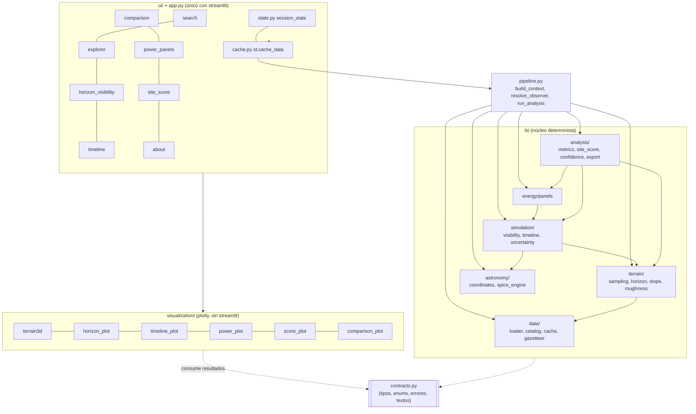

# LSI — Arquitectura (v1.1, 14/11/2026)

Autor: arquitecto de software. Fuentes: `CLAUDE.md`, `docs/reto-nasa.md`, `docs/documento-base.txt`, `docs/science/*` y `config/*.json`.
Tipos exactos en `src/lsi/contracts.py` (fuente de verdad de dataclasses, enums, excepciones y textos de aviso). Este documento fija **módulos, firmas, caché, exportación, errores, rendimiento, pantallas y tareas**. Si una firma de aquí y `contracts.py` discrepan, manda `contracts.py` y se corrige el documento.

---

## 0. Decisiones que condicionan la implementación

| # | Decisión | Se gana | Se renuncia a |
|---|---|---|---|
| D1 | Monolito modular Python 3.11, un solo proceso. Streamlit+Plotly (+PyDeck opcional). | Un equipo pequeño entrega en días; núcleo testeable sin UI. | Escalado horizontal (no hace falta: cálculo por sesión < 20 s). |
| D2 | `lsi/` no importa `streamlit` (solo `ui/` y `app.py`). `visualization/` puede importar `plotly`, devuelve `go.Figure`. | UI intercambiable; tests sin servidor. | Cachés de Streamlit dentro del núcleo (se ponen en `ui/cache.py`). |
| D3 | Orquestación en `lsi/pipeline.py` (`run_analysis`). Las páginas no cablean 8 módulos. | Un solo punto de integración, testeable end-to-end. | Páginas "listas para jugar" con el motor a mano. |
| D4 | Caché **direccionada por contenido** (hash), sin invalidación manual. | Imposible servir datos obsoletos. | Espacio en disco (LRU con tope 500 MB). |
| D5 | Dos modos de horizonte: `DEM` y `SMOOTH_SPHERE`. Un punto sin cobertura cae a esfera lisa **con aviso**, nunca a error. Excepciones solo para punto cerca del borde / nodata (la UI pide otro punto). | "Cualquier lugar" del buscador es evaluable. | Silencio: el modo se muestra siempre en cabecera. |
| D6 | Horizonte = `H_lb` (cota inferior) + `H_ub` opcional + bandera por azimut. Visibilidad nominal = optimista; el rango sale de `H_ub`. | Honestidad ante la cobertura de ~16 km. | Una cifra única "limpia". |
| D7 | Fracción de disco analítica si el horizonte es constante (esfera lisa); rebanadas (n=64) si hay relieve (DEM solo polar, e ≤ 8°). | Exacta en todo el globo; la aproximación `x/cos e` solo se usa donde vale. | — |
| D8 | Refinamiento de eventos por **bisección vectorizada** (todos los eventos a la vez, ~10 iteraciones), no `brentq` por evento. | 10-100× menos llamadas a SPICE. | Elegancia de `brentq` (equivalente a xtol 1 s). |
| D9 | Score sin datos de terreno = **parcial, marcado y con rango** (§5.9), nunca una cifra "completa". | No fingir precisión en esfera lisa. | Un ranking único y comparable de todo el catálogo. |
| D10 | `numba` NO se usa. NumPy vectorizado cumple presupuestos (§10). | Cero dependencias nuevas. | Margen si se pide ΔA/Δr más finos. |

### Conflictos entre expertos y cómo se resuelven

| Tema | Fuente A | Fuente B | Decisión |
|---|---|---|---|
| Radio de la Tierra (tamaño angular) | `matematica.md` §4.1: 6371 km | `convenciones.md`: 6378.137 km (fuente de verdad) | **6378.137 km**. Los tests de matemática sobre ρ_Tierra usan el valor que declare cada caso. |
| IAM, índice de cubierta | matematica: 1.526, Fresnel 1 interfaz | panels.json: n=1.46, `cosine_only` | Modelo por defecto `fresnel_1_interface`; **n del panel prevalece** si existe, si no 1.526. Tests de §6.7 pasan `n=1.526` explícito. |
| Tope de eficiencia en frío | matematica: η_max 1.35, T≥173.15 K | panels.json: `cold_gain_cap` 1.15 | Prevalece el del panel/catálogo (1.15); 1.35 es *fallback*. |
| T de referencia de célula | matematica: 25 °C | panels.json: 28 °C por panel | `ref_temperature_c` del panel. Tests de matemática pasan 25 °C. |
| Exclusión de campo cercano | matematica: Δr desde 5 m | terreno-geologia: ≥ 15 m | `r_min_m=5` por defecto (tests H1–H7 válidos); 15 m es opción "conservadora" en UI y sensibilidad. |
| Pendiente máx. de aterrizaje | matematica G2: 20° | panels.json: 10° diseño (lander) | G2 usa el valor de diseño del perfil si existe; 20° si no. |
| Perfiles del score | matematica: 3 perfiles | panels.json: 5 perfiles de misión | Score usa las **claves de panels.json** (+`custom`); pesos de `lander_with_batteries` y `base_isru` = los de lander (suposición, etiquetada). |
| `dem_dir` de sites.json | `data/raw/dem/site04` | disco real: `data/raw/shackleton/` | `dem_dir` es marcador obsoleto: el loader descubre por glob `data/raw/*/{prefix}_final_adj_5mpp_*.tif`. |
| Coordenadas curadas de Site04/Site11 | sites.json (centros de cráter) | Proyectadas: x=7690 m (> 7000) y Site11 x=−45429 (< −45000): **fuera del recorte** | `simulation.json: dem_default_observers` (centro del recorte). Site23 sí cae dentro. Aviso `CURATED_COORDS_OUTSIDE_DEM`. |
| Rango UTC | 1900-01-01…2050-12-31 23:58:51 | probado 2050-12-30 OK | UI/validación: `1900-01-02 … 2050-12-30` (margen por light-time); el motor además traduce `SpiceyPyError` a `DateOutOfRangeError`. |

---

## 1. Requisitos

### 1.1 Funcionales

| ID | Requisito | Prioridad |
|---|---|---|
| RF-01 | Selector de sitios curado (`config/sites.json`, 32; los de lat/lon nulos aparecen deshabilitados con "a verificar"). | Must |
| RF-02 | Coordenadas personalizadas (lat/lon, altura del observador). Con cobertura DEM → modo DEM; sin ella → esfera lisa (sin relieve) con aviso. | Must |
| RF-03 | Sol y Tierra vs. horizonte (az/el, discos finitos, estado visible/parcial/oculto) a un instante dado. | Must |
| RF-04 | Cuenta atrás hasta puesta de Sol / Earthset (y salida), con indicador "aproximado por cobertura". | Must |
| RF-05 | Timeline de ventanas Sol / Tierra / solape / oscuridad; ventana más larga; truncadas marcadas "≥". | Must |
| RF-06 | Comparación de 2-4 sitios lado a lado (métricas, confianza). | Must |
| RF-07 | Exportación CSV/JSON con metadatos completos y avisos (§7). | Must |
| RF-08 | Selector de tipo de panel (`panels.json`) y montaje; curva de % de potencia sobre el día/periodo; energía diaria; batería opcional. | Must |
| RF-09 | Score de idoneidad con puertas, desglose, perfiles, pesos editables y rango. | Must |
| RF-10 | **Buscador de rasgos lunares por nombre (gazetteer IAU/USGS):** nombre, tipo, lat/lon, diámetro, origen del nombre; búsqueda difusa sin acentos; filtros por tipo y región; botón "Evaluar este lugar" → motor (DEM si hay cobertura, esfera lisa si no). | **Must** |
| RF-11 | El score se evalúa para **cualquier** lugar del buscador; en esfera lisa muestra "sin datos de terreno" explícito, parcial y con rango (§5.9). | **Must** |
| RF-12 | Explorer 3D del DEM (capas elevación/pendiente/incertidumbre/muestreo) y mapa polar 2D. | Should |
| RF-13 | Propagación de incertidumbre (cobertura, σz, discretización) como rango. | Should |
| RF-14 | Modo "divulgación" (textos simples) vs "técnico". | Could |
| RF-15 | Avisos científicos siempre visibles (§9.3). | Must |
| RF-16 | Validación contra JPL Horizons (script + `docs/science/validacion-horizons.md`). | Should |

### 1.2 No funcionales

| ID | Requisito |
|---|---|
| RNF-01 | Determinismo: misma entrada → mismo resultado; sin aleatoriedad. El *timestamp* de export va en metadatos y se excluye de hashes. |
| RNF-02 | Rendimiento: horizonte de un punto < 2 s; 30 d a 10 min < 3 s; 1 año < 20 s (§10). |
| RNF-03 | `lsi/` sin `streamlit`; `ui/` sin cálculo científico. |
| RNF-04 | Cada función con lógica deja test con valor esperado independiente (CLAUDE.md). |
| RNF-05 | Cifras sin fuente = etiqueta `a verificar`/`suposición` visible en UI. |
| RNF-06 | Arranque desde entorno limpio (§12.3). |
| RNF-07 | Sin red en ejecución: datos y kernels vía `scripts/fetch_*.py`; si falta el gazetteer la app arranca con el catálogo curado y lo avisa. |

---

## 2. Diagrama de módulos y flujo de datos



Flujo de una petición `AnalysisRequest` (punto + periodo + panel + perfil):

```
lat,lon ──resolve_observer──► ObserverPoint (modo DEM | esfera lisa; aviso si cae fuera)
   │                              │ DEM: read_window → DemWindow (+ metadatos, sha256)
   ▼                              ▼
terrain.horizon.compute_horizon ◄─cache(data/processed/horizons/<key>.npz)
   │ HorizonResult (H_lb, H_ub, r_cov, limited)
   ▼
astronomy.spice_engine.sky_series(et grid) ──► SkySeries (az, el, dist, ρ de Sol y Tierra)
   ▼
simulation.visibility ──► VisibilitySeries (f por instante, estado, unknown_relevant)
   ▼
simulation.timeline ──► TimelineResult (ventanas refinadas, eventos, solape, oscuridad)
   ├─► analysis.metrics ──► SiteMetrics ──► simulation.uncertainty (rangos)
   ├─► energy.panels ──► PowerSeries / PowerSummary / Battery
   ├─► terrain.slope/roughness + analysis.confidence ──► SlopeStats, DemConfidence
   └─► analysis.site_score ──► SiteScoreResult (+ ScientificWarning[])
                       ▼
                 AnalysisResult ──► visualization.* ──► ui.pages.*  /  analysis.export
```

---

## 3. Responsabilidad y ficheros por módulo

| Módulo | Fichero(s) | Responsabilidad | Depende de |
|---|---|---|---|
| `contracts` | `src/lsi/contracts.py` | Tipos, enums, errores, constantes, avisos. Sin lógica. | numpy |
| `data.loader` | `data/loader.py` | Descubrir DEM, validar CRS, leer ventanas, metadatos, máscara de validez, sha256. | rasterio, contracts |
| `data.catalog` | `data/catalog.py` | Cargar `sites.json`, `simulation.json` y construir parámetros tipados; `dem_default_observers`. | contracts |
| `data.cache` | `data/cache.py` | Claves por hash, lectura/escritura `npz`, purga LRU. | contracts |
| `data.gazetteer` | `data/gazetteer.py` | Cargar catálogo procesado, normalizar texto, buscar (difuso/filtros), cobertura DEM, convertir a petición. | pandas, coordinates |
| `terrain.sampling` | `terrain/sampling.py` | Interpolación bilineal centrada con máscara de validez. | contracts |
| `terrain.horizon` | `terrain/horizon.py` | Horizonte con curvatura, H_lb/H_ub/r_cov/limited; esfera lisa; interpolación circular. | sampling, coordinates |
| `terrain.slope` / `roughness` | `terrain/slope.py`, `roughness.py` | Pendiente (mapa y huella), rugosidad RMS. | sampling |
| `astronomy.coordinates` | `astronomy/coordinates.py` | Estereográfica polar, base ENU, az/el desde vectores MOON_ME, direcciones de rayo. Sin SPICE. | numpy |
| `astronomy.spice_engine` | `astronomy/spice_engine.py` | Kernels, rango de fechas, az/el/dist/radio de Sol y Tierra (LT+S), `Lock`. | spiceypy, coordinates |
| `simulation.visibility` | `simulation/visibility.py` | Fracción de disco (analítica y por rebanadas), clasificación, `unknown_relevant`. | horizon |
| `simulation.timeline` | `simulation/timeline.py` | Ventanas, refinamiento, álgebra de intervalos, eventos, cuenta atrás. | visibility, spice_engine |
| `simulation.uncertainty` | `simulation/uncertainty.py` | Escenarios (H_ub, ±kσz, ΔA 0.5°) → `Range` por métrica. | timeline, horizon |
| `energy.panels` | `energy/panels.py` | Catálogo, cos θ por montaje, IAM, temperatura, P_rel, energía, batería. | contracts |
| `analysis.metrics` | `analysis/metrics.py` | `SiteMetrics`, ventana más larga/oscuridad máx., tabla diaria, comparación. | timeline |
| `analysis.site_score` | `analysis/site_score.py` | Subindicadores, puertas, media geométrica, perfiles, rango, modo parcial. | contracts |
| `analysis.confidence` | `analysis/confidence.py` | `DemConfidence` (g90/e90/DC) y `DataConfidence`. | contracts |
| `analysis.export` | `analysis/export.py` | JSON y bundle CSV (§7). | metrics |
| `pipeline` | `pipeline.py` | `build_context`, `resolve_observer`, `run_analysis`. Único que cablea módulos. | todos |
| `visualization.*` | `visualization/{theme,terrain3d,horizon_plot,timeline_plot,power_plot,score_plot,comparison_plot}.py` | Figuras Plotly puras (reciben resultados, devuelven `Figure`). | plotly, contracts |
| `ui` | `app.py`, `ui/{state,cache,components,sidebar}.py`, `ui/pages/*.py` | Streamlit. Sin cálculo. | streamlit, pipeline, visualization |
| scripts | `scripts/fetch_data.py` (existe), `fetch_gazetteer.py`, `precompute_horizons.py` | Datos reproducibles. | requests |

Los subpaquetes se crean con su propio `__init__.py` vacío (el implementador del primer fichero del subpaquete). `src/lsi/__init__.py` solo define `__version__`.

**Reglas de dependencia** (comprobables con un test de imports): `contracts` ← todo; `astronomy.coordinates` y `data.*` no importan `terrain`/`simulation`; `terrain` no importa `simulation`/`astronomy.spice_engine`; `simulation` no importa `energy`/`analysis`; `visualization` solo importa `contracts`; `ui` solo importa `pipeline`, `visualization`, `contracts`, `data.catalog`/`data.gazetteer`.

---

## 4. Convenciones de implementación

- Unidades: sufijos en identificadores (`_deg`, `_m`, `_km`, `_s`, `_k`). Radianes solo dentro de funciones NumPy.
- DEM en memoria: `float32`; los gathers se convierten a `float64` antes de la geometría.
- Índice de píxel centrado: `col=(x−x0_m)/px`, `row=(y0_m−y)/px`. `rasterio.index()` NO se usa para interpolar.
- Azimut de rayo en el plano: dirección `(sin(λ+A), cos(λ+A))` (matematica §1.2). `atan2(x, y)`, no `(y, x)`.
- Nodata nunca se convierte en 0. Muestra inválida ⇒ elevación `−inf` y marca `limited`.
- SPICE es estado global y no es thread-safe: todo acceso bajo `spice_engine.SPICE_LOCK` (Streamlit usa un hilo por sesión).
- Sin aleatoriedad, sin reloj en el núcleo (el "ahora" lo inyecta quien llama).

---

## 5. Contratos de funciones

`Path` = `pathlib.Path`; `F` = `FloatArray`; todos los tipos son de `lsi.contracts`. Docstring de una línea indicado tras `—`.

### 5.1 `data.loader`

```python
def discover_dems(raw_dir: Path) -> dict[str, DemRef]:
    """— Busca data/raw/*/SiteNN_final_adj_5mpp_{surf,slp,ldec,toterr}.tif; clave 'SiteNN'. Vacío si no hay."""

def read_metadata(ref: DemRef, layer: DemLayer = DemLayer.SURF) -> DemMetadata:
    """— Lee cabecera, valida CRS (DEM_CRS_MUST_CONTAIN; DemCrsMismatchError) y calcula sha256 (cacheado en sidecar)."""

def read_window(ref: DemRef, layer: DemLayer = DemLayer.SURF,
                bounds_xy_m: tuple[float, float, float, float] | None = None, *, margin_px: int = 0) -> DemWindow:
    """— Lee una ventana (None = capa completa) como DemWindow float32 con NaN en nodata; no carga el raster entero si hay ventana."""

def validity_mask(window: DemWindow) -> BoolArray:
    """— True donde el píxel es finito y distinto de nodata."""

def find_dem_for_point(refs: Mapping[str, DemRef], x_m: float, y_m: float, margin_m: float = 0.0) -> DemRef | None:
    """— DEM cuya huella contiene el punto con margen interior de margin_m; None si ninguno."""

def dem_sha256(ref: DemRef, layer: DemLayer = DemLayer.SURF) -> str:
    """— Hash del fichero (sidecar data/processed/dem_hash.json por (ruta, tamaño, mtime_ns))."""
```

Errores: `DemNotFoundError` (faltan ficheros), `DemCrsMismatchError`. Carga de Malapert (21 km, 4200²) en ventana ±(r_max) alrededor del punto para acotar RAM.

### 5.2 `data.catalog`

```python
def load_sites(path: Path) -> tuple[SiteSpec, ...]:
    """— Parsea sites.json; claves que empiezan por '_' ignoradas; lat/lon null conservados como None."""

def load_simulation_config(path: Path) -> dict:
    """— Lee simulation.json y valida claves obligatorias y rangos (INVALID_PARAMETER si fallan)."""

def horizon_params(cfg: Mapping, observer_height_m: float | None = None) -> HorizonParams: ...
def visibility_params(cfg: Mapping) -> VisibilityParams: ...
def timeline_params(cfg: Mapping, step_s: float | None = None) -> TimelineParams: ...
def uncertainty_params(cfg: Mapping) -> UncertaintyParams: ...
def score_params(cfg: Mapping) -> ScoreParams: ...
def score_profiles(cfg: Mapping) -> dict[str, ScoreProfile]:
    """— Perfiles del score (claves de panels.json + 'custom'); pesos tal cual, se renormalizan al evaluar."""

def default_observer(cfg: Mapping, dem_key: str) -> tuple[float, float] | None:
    """— (lat, lon_e) de dem_default_observers para un DEM; None si no hay."""
```

### 5.3 `data.cache`

```python
def digest(*parts: object) -> str:
    """— sha256 hex de la serialización JSON canónica (claves ordenadas, floats redondeados) de las partes."""

def horizon_key(dem_sha256: str | None, mode: HorizonMode, x_m: float, y_m: float,
                params: HorizonParams) -> str:
    """— Clave = digest(CACHE_ALGORITHM_VERSION, dem_sha256, mode, x,y redondeados a coord_round_m, params)."""

def load_npz(cache_dir: Path, kind: str, key: str) -> dict[str, np.ndarray] | None:
    """— Lee <cache_dir>/<kind>/<key>.npz o None; corrupto = se borra y devuelve None."""

def save_npz(cache_dir: Path, kind: str, key: str, arrays: Mapping[str, np.ndarray]) -> Path:
    """— Escritura atómica (tmp + rename)."""

def purge(cache_dir: Path, max_bytes: int) -> int:
    """— Borra los ficheros menos recientes hasta caber en max_bytes; devuelve bytes liberados."""
```

### 5.4 `terrain.sampling`

```python
def sample_bilinear(window: DemWindow, x_m: F, y_m: F) -> tuple[F, BoolArray]:
    """— Valor bilineal (convención centrada) y máscara; inválido si cae fuera o algún vecino es NaN."""

def pixel_coords(window: DemWindow, x_m: F, y_m: F) -> tuple[F, F]:
    """— (col, row) continuas centradas."""
```

### 5.5 `terrain.horizon`

```python
def smooth_sphere_horizon_deg(height_m: float) -> float:
    """— −acos(R/(R+h)) en grados (esfera lisa)."""

def compute_horizon(window: DemWindow, observer: ObserverPoint, params: HorizonParams,
                    sigma_window: DemWindow | None = None, sigma_sign: int = 0, k_sigma: float = 0.0,
                    cache_dir: Path | None = None) -> HorizonResult:
    """— Horizonte exacto con curvatura (H_lb, r_cov, limited, opcional H_ub); sigma_sign=±1 aplica z±k·σz (TOTERR)."""

def smooth_sphere_result(observer: ObserverPoint, params: HorizonParams) -> HorizonResult:
    """— Resultado con H ≡ H_esfera(h), r_cov=∞, limited=False (modo SMOOTH_SPHERE)."""

def horizon_at(result: HorizonResult, az_deg: F, kind: str = "lb") -> F:
    """— Interpolación lineal circular (periodo 360°) de H_lb ('lb') o H_ub ('ub')."""

def unknown_relevant_mask(result: HorizonResult, az_deg: F, el_deg: F, radius_deg: F) -> BoolArray:
    """— True si el azimut está limitado por cobertura y H_lb < el + radio (puede cambiar el resultado)."""

def limited_fraction(result: HorizonResult, e_max_deg: float, radius_deg: float) -> float:
    """— Fracción de azimutes limitados con H_lb < e_max + ρ (alimenta G3 y 'horizonte limitado por cobertura')."""
```

Algoritmo: matematica §2.4 con dos optimizaciones obligatorias: (1) se maximiza `tan(el) = num/den` (den = (R+z)·sin ψ > 0) y se aplica un solo `arctan` por azimut; (2) bloques de `block_azimuths` rayos y `N` recortado al `r_cov` máximo del bloque. Salida determinista; el hash de salida debe ser idéntico entre ejecuciones.

### 5.6 `terrain.slope` y `terrain.roughness`

```python
def slope_map_deg(window: DemWindow, baseline_m: float = 10.0) -> F:
    """— Pendiente por diferencia central (baseline 10 m, como la capa slp); NaN en bordes/inválidos."""

def footprint_slope(surf: DemWindow, x_m: float, y_m: float, r_foot_m: float = 50.0,
                    percentile: float = 90.0, slp: DemWindow | None = None) -> SlopeStats:
    """— Percentil de pendiente en el disco de la huella; usa slp si se da, si no deriva de surf."""

def roughness_rms_m(surf: DemWindow, x_m: float, y_m: float, r_m: float = 50.0, detrend: bool = True) -> float:
    """— RMS de la altura tras ajustar y restar un plano dentro del disco."""
```

### 5.7 `astronomy.coordinates`

```python
def stereo_forward(lat_deg: F, lon_deg_e: F) -> tuple[F, F]:
    """— (lat, lon_E) → (x, y) m, estereográfica polar sur R=1737.4 km (ρ=2R·cosφ/(1−sinφ))."""

def stereo_inverse(x_m: F, y_m: F) -> tuple[F, F]:
    """— (x, y) → (lat, lon_E en 0..360); en ρ=0 devuelve lon=0."""

def normalize_lon(lon_deg: F, west_positive: bool = False) -> F:
    """— Lleva a este-positiva 0..360."""

def enu_basis(lat_deg: float, lon_deg_e: float) -> np.ndarray:
    """— Matriz 3×3 con filas E, N, U expresadas en MOON_ME."""

def vector_to_azel(v_km: F, lat_deg: float, lon_deg_e: float) -> tuple[F, F, F]:
    """— v (N,3) en MOON_ME relativo al observador → (az 0-360, el, distancia); en cenit/nadir az=0."""

def observer_position_km(lat_deg: float, lon_deg_e: float, height_m: float = 0.0) -> F:
    """— Posición (3,) del observador en MOON_ME: (R+h)·Û."""

def ray_direction(lon_deg_e: float, az_deg: F) -> tuple[F, F]:
    """— (dx, dy) = (sin(λ+A), cos(λ+A)) en el plano estereográfico."""
```

### 5.8 `astronomy.spice_engine`

```python
SPICE_LOCK: threading.Lock   # obligatorio alrededor de toda llamada a spiceypy

def load_kernels(kernel_dir: Path) -> KernelInfo:
    """— Carga idempotente de los 6 kernels (KernelsMissingError) y calcula et_min/et_max del BPC."""

def utc_to_et(utc: str) -> float:
    """— UTC ISO → ET (TDB); DateOutOfRangeError si fuera de [UTC_MIN, UTC_MAX]."""

def et_to_utc(et: F | float, fmt: str = "ISOC", prec: int = 0) -> str | list[str]:
    """— ET → cadena(s) UTC ISO (spiceypy.et2utc)."""

def et_grid(et0: float, et1: float, step_s: float) -> F:
    """— Rejilla ET [et0, et1] inclusive del extremo si cae en la rejilla; nunca suma segundos a UTC."""

def angular_radius_deg(dist_km: F, body: Body) -> F:
    """— asin(R_cuerpo/d) en grados (Sol 695700 km, Tierra 6378.137 km)."""

def body_track(et: F, lat_deg: float, lon_deg_e: float, body: Body, height_m: float = 0.0) -> BodyTrack:
    """— spkpos vectorizado (MOON_ME, LT+S, centro MOON) − observador (paralaje) → az/el/dist/radio."""

def sky_series(et: F, lat_deg: float, lon_deg_e: float, height_m: float = 0.0) -> SkySeries:
    """— BodyTrack de Sol y Tierra sobre ``et`` con el hash de kernels."""
```

El rango válido se expone con `KernelInfo.utc_min/utc_max` y las constantes `UTC_MIN/UTC_MAX`. Toda `SpiceyPyError` de marco se traduce a `DateOutOfRangeError`.

### 5.9 `simulation.visibility`

```python
def disc_fraction_flat(t: F) -> F:
    """— f(t)=½+(t√(1−t²)+asin t)/π con t=(e−H)/ρ; 0 si t≤−1, 1 si t≥1."""

def disc_fraction(el_deg: F, az_deg: F, radius_deg: F, horizon: HorizonResult, kind: str = "lb",
                  n_slices: int = 64, limb_darkening_u: float = 0.0) -> F:
    """— Fracción de disco visible con H(A) variable (rebanadas, matematica §4.3); analítica si H es constante."""

def classify(f: F, eps: float = 1e-3) -> IntArray:
    """— VisibilityState int8: HIDDEN f≤eps, VISIBLE f≥1−eps, PARTIAL resto."""

def visibility_series(sky: SkySeries, horizon: HorizonResult, params: VisibilityParams) -> VisibilitySeries:
    """— f, estado, unknown_relevant y f_pess (H_ub) de Sol y Tierra; por bloques de 8192 instantes."""

def make_fraction_fn(body: Body, lat_deg: float, lon_deg_e: float, height_m: float, horizon: HorizonResult,
                     params: VisibilityParams) -> Callable[[F], F]:
    """— f(et) vectorizado (SPICE + disc_fraction) para refinar eventos."""
```

### 5.10 `simulation.timeline`

```python
def find_windows(et: F, f: F, thr: float, label: str, criterion: str, *,
                 f_fn: Callable[[F], F] | None = None, xtol_s: float = 1.0) -> WindowSet:
    """— Ventanas f>thr; con f_fn refina cada transición por bisección vectorizada hasta xtol_s; trunca en bordes."""

def refine_crossings(f_fn: Callable[[F], F], et_lo: F, et_hi: F, thr: float, xtol_s: float = 1.0) -> F:
    """— Bisección vectorizada (misma iteración para todos los eventos) → ET de cada cruce."""

def union_windows(a: WindowSet, b: WindowSet, tol_s: float = 1.0) -> WindowSet:
    """— Unión: fusiona si el hueco ≤ tol_s."""

def intersect_windows(a: WindowSet, b: WindowSet, label: str = "overlap") -> WindowSet:
    """— Intersección por dos punteros O(n+m); propaga truncamientos."""

def complement_windows(ws: WindowSet, label: str = "dark") -> WindowSet:
    """— Complemento sobre [t0, t1]; marca truncadas las que tocan los bordes."""

def run_timeline(sky: SkySeries, horizon: HorizonResult, vis_params: VisibilityParams,
                 params: TimelineParams, vis: VisibilitySeries | None = None) -> TimelineResult:
    """— Ventanas Sol/Tierra/solape/oscuridad con refinamiento, eventos con az, y variante pesimista (H_ub)."""

def countdown(now_et: float, body: Body, lat_deg: float, lon_deg_e: float, height_m: float,
              horizon: HorizonResult, vis_params: VisibilityParams, params: TimelineParams) -> Countdown:
    """— Próxima transición del cuerpo en ≤ countdown_search_days; marca approximate_due_to_coverage."""
```

### 5.11 `simulation.uncertainty`

```python
def run_uncertainty(ctx_window: DemWindow | None, sigma_window: DemWindow | None, observer: ObserverPoint,
                    horizon_nominal: HorizonResult, sky: SkySeries, vis_params: VisibilityParams,
                    tl_params: TimelineParams, hz_params: HorizonParams, params: UncertaintyParams,
                    metrics_nominal: SiteMetrics) -> UncertaintyResult:
    """— Recalcula escenarios (H_ub, z±kσz, ΔA 0.5°, altura±Δ) y devuelve Range por métrica; sin DEM solo altura."""
```

### 5.12 `energy.panels`

```python
def load_panel_catalog(path: Path) -> PanelCatalog:
    """— Parsea panels.json: %→fracción, null→None, ignora claves '_'; mission_profiles → MissionProfile."""

def get_panel(catalog: PanelCatalog, panel_id: str) -> PanelSpec:
    """— Busca por id (KeyError con la lista de ids válidos)."""

def incidence_cos(az_deg: F, el_deg: F, mounting: MountingSpec, ground_normal_enu: tuple[float, float, float] | None = None) -> F:
    """— cos θ_inc por montaje (matematica §6.3), sin recortar; la potencia aplica max(0,·)."""

def iam(theta_deg: F, spec: IamSpec, n_default: float = 1.526) -> F:
    """— Fresnel una interfaz normalizado a T(0); 'cosine_only' → 1; IAM(θ≥90°)=0."""

def panel_temperature_k(g_inc_w_m2: F, panel: PanelSpec, t_ambient_k: float, eta_ref: float | None = None) -> F:
    """— Balance radiativo estacionario (matematica §6.5); PanelNotCalculableError si faltan α/ε."""

def eta_rel(t_k: F, panel: PanelSpec, params: PowerParams, catalog: PanelCatalog) -> tuple[F, BoolArray]:
    """— 1+γ_T·(T−T_ref) con T acotada a t_min_valid_k y tope cold_gain_cap; devuelve (η_rel, t_clamped)."""

def relative_power(et: F, sun: BodyTrack, f_sun: F, panel: PanelSpec, params: PowerParams,
                   catalog: PanelCatalog, ground_normal_enu=None) -> PowerSeries:
    """— P_rel = f·max(0,cosθ)·IAM·η_rel·(UA/d)²·(1−deg)·(1−polvo)·f_shadow; sin recortar a 1."""

def integration_nodes(et_grid: F, windows: Sequence[WindowSet]) -> F:
    """— Unión ordenada de la rejilla y los instantes de evento refinados."""

def summarize_power(series: PowerSeries, panel: PanelSpec, useful_threshold: float,
                    catalog: PanelCatalog) -> PowerSummary:
    """— E_rel, % del máximo teórico, E_inc, E_el, pico, horas útiles y tabla diaria UTC (trapecio sobre nodos)."""

def simulate_battery(et: F, p_rel: F, params: BatteryParams) -> BatteryResult:
    """— Integrador de matematica §6.8 (carga/descarga con rendimientos, SOC_min, energía no servida)."""
```

### 5.13 `analysis.metrics`

```python
def compute_metrics(tl: TimelineResult, sky: SkySeries, horizon: HorizonResult,
                    vis_params: VisibilityParams) -> SiteMetrics:
    """— Fracciones, ventana más larga, oscuridad máxima (con flag truncada), solape y fracciones desconocidas."""

def longest_window(ws: WindowSet) -> tuple[float, bool]:
    """— (duración s, truncada) de la ventana más larga; (0, False) si no hay."""

def daily_table(tl: TimelineResult) -> list[dict]:
    """— Por día UTC: iluminación media, horas de Sol, horas de Tierra, horas de solape."""

def comparison_table(results: Mapping[str, SiteMetrics]) -> list[dict]:
    """— Filas {metric, unit, <site_id>: valor...} para la pantalla y CSV de comparación."""
```

### 5.14 `analysis.site_score`

```python
def subscores(inputs: ScoreInputs, profile: ScoreProfile, params: ScoreParams) -> dict[str, float | None]:
    """— s_sun, s_night, s_earth, s_terrain en [0,1]; s_terrain=None si slope_p90_deg es None (sin DEM)."""

def evaluate_gates(inputs: ScoreInputs, profile: ScoreProfile, params: ScoreParams,
                   mission: MissionProfile | None) -> tuple[GateResult, ...]:
    """— G1 energía, G2 pendiente (diseño del perfil), G3 datos/sin terreno, G4 noche hard del perfil."""

def compute_score(inputs: ScoreInputs, profile: ScoreProfile, params: ScoreParams,
                  mission: MissionProfile | None = None, weights_override: Mapping[str, float] | None = None) -> SiteScoreResult:
    """— Media geométrica ponderada con desglose, eslabón débil y puertas; parcial si falta terreno (§5.9)."""

def score_with_range(nominal: ScoreInputs, scenarios: Sequence[ScoreInputs], profile: ScoreProfile,
                     params: ScoreParams, mission: MissionProfile | None = None) -> SiteScoreResult:
    """— compute_score del nominal con score_min/max = extremos de los escenarios."""

def earth_reference_fraction(f_earth_on_smooth_sphere: float) -> float:
    """— Identidad documentada: f_E,ref lo mide el pipeline con H≡H_esfera; aquí solo se valida >0."""
```

**§5.9 — Score sin datos de terreno (modo esfera lisa).** Reglas obligatorias:
1. `ScoreInputs.slope_p90_deg = None` y `has_dem=False`. `s_terrain` no se evalúa (ni 0 ni 1).
2. Puerta G3 = `NO_DATA` con motivo "sin datos de terreno (esfera lisa)"; `terrain_data=False`, `partial=True`, `missing_keys=("terrain",)`, `attenuated=True`.
3. Valor nominal = media geométrica **renormalizando** los pesos de los tres subindicadores restantes. Rango: `score_min` = con `s_terrain=ε_s` (sin renormalizar), `score_max` = con `s_terrain=1`. El rango será amplio a propósito.
4. Sol y noche en esfera lisa se calculan **sin relieve** (optimistas): aviso `NO_TERRAIN_DATA_SCORE` y `NO_DEM_SMOOTH_SPHERE` visibles junto a la cifra; el score nunca aparece en un ranking junto a sitios con DEM sin la etiqueta "parcial".
5. G1/G2/G4 se evalúan solo con lo que hay (G2 = `NO_DATA`, no `PASS`).
6. Si el periodo analizado es < 29.5 d, la UI avisa que `D_max` y `f_sol` no son representativos (recomendado ≥ 1 mes sinódico; un año para el polo).

### 5.15 `analysis.confidence`

```python
def dem_confidence(ldec: DemWindow, toterr: DemWindow, x_m: float, y_m: float, horizon: HorizonResult,
                   cfg: Mapping) -> DemConfidence:
    """— g90 (distancia a píxel con retorno), e90 (toterr), f_obs, clase ALTA/MEDIA/BAJA y DC; baja un nivel si azimutes abiertos > 10 %."""

def data_confidence(c_cov: float, c_sup: float, c_range: float, dem: DemConfidence | None,
                    params: ScoreParams) -> DataConfidence:
    """— C=min(c_cov,c_sup,c_range) y etiqueta alta/media/baja."""
```

### 5.16 `analysis.export`

```python
def result_to_dict(result: AnalysisResult) -> dict:
    """— Estructura JSON del §7 (sin numpy, floats redondeados según config)."""

def write_json(result: AnalysisResult, path: Path) -> Path:
    """— Escribe result_to_dict con indent=2 y UTF-8."""

def write_csv_bundle(result: AnalysisResult, out_dir: Path) -> dict[str, Path]:
    """— timeseries.csv, windows.csv, horizon.csv, metrics.csv y metadata.json (columnas CSV_*_COLUMNS)."""

def comparison_to_csv(rows: list[dict], path: Path) -> Path:
    """— Tabla de comparación (CSV_COMPARISON_COLUMNS + una columna por sitio)."""
```

### 5.17 `data.gazetteer` (buscador)

Origen: USGS Gazetteer of Planetary Nomenclature (IAU WGSN), Luna. URL de descarga y esquema exacto: **a verificar** en la primera ejecución de `scripts/fetch_gazetteer.py` (el script falla con mensaje claro si el formato cambia; nunca inventa filas).

```python
def normalize_text(s: str) -> str:
    """— minúsculas, sin diacríticos (unicodedata NFKD), sin puntuación sobrante, espacios colapsados."""

def region_of(lat_deg: float) -> str:
    """— 'polo_sur' <−80°, 'sur', 'ecuatorial', 'norte', 'polo_norte' según simulation.json: gazetteer.regions."""

def load_gazetteer(path: Path | None = None) -> "pandas.DataFrame":
    """— Lee data/processed/gazetteer.parquet (o .csv); GazetteerNotFoundError si no existe; columnas = campos de GazetteerEntry."""

def annotate_dem_coverage(df: "pandas.DataFrame", refs: Mapping[str, DemRef], margin_m: float = 10.0) -> "pandas.DataFrame":
    """— Añade has_dem/dem_key proyectando lat/lon (stereo_forward) contra las huellas DEM."""

def search(df: "pandas.DataFrame", query: GazetteerQuery) -> list[GazetteerEntry]:
    """— Prefiltro por tipo/región/diámetro/DEM; coincidencia: exacta > prefijo > subcadena > difusa (difflib, cutoff 0.62); orden estable."""

def list_feature_types(df: "pandas.DataFrame") -> list[tuple[str, int]]:
    """— (tipo, nº de rasgos) ordenado por frecuencia para el filtro de la UI."""

def get_entry(df: "pandas.DataFrame", feature_id: int) -> GazetteerEntry:
    """— Entrada por ID (KeyError si no existe)."""

def to_request(entry: GazetteerEntry, start_utc: str, end_utc: str, observer_height_m: float = 2.0,
               **kw) -> AnalysisRequest:
    """— AnalysisRequest con lat/lon del rasgo y gazetteer_id; el modo DEM/esfera lo decide pipeline.resolve_observer."""
```

Reglas: la búsqueda "shackleton", "Shackleton", "SHACKLETÓN" y "shakleton" (difusa) devuelven el mismo rasgo. Longitudes del origen oeste-positivas se convierten en `fetch_gazetteer.py`. El gazetteer da el **centro** del rasgo: aviso `GAZETTEER_COORDS_APPROX` y selector de punto dentro del rasgo. Rasgos con `diameter_km` nulo se aceptan. Los 3 DEM (`Site04/11/23`) se enlazan por huella, no por nombre.

### 5.18 `pipeline`

```python
def build_context(root: Path) -> AppContext:
    """— Carga config, kernels, DEM descubiertos, panels y sites una sola vez; no falla si no hay DEM (RF-02)."""

def resolve_observer(ctx: AppContext, lat_deg: float, lon_deg_e: float, height_m: float, *,
                     site_id: str | None = None, force_smooth_sphere: bool = False) -> tuple[ObserverPoint, tuple[ScientificWarning, ...]]:
    """— DEM si hay cobertura (con margen edge_margin_px); esfera lisa si no (aviso); lanza ObserverNearEdge/NodataAtObserver."""

def run_analysis(ctx: AppContext, req: AnalysisRequest) -> AnalysisResult:
    """— Flujo completo §2; solo hace lo que pide la petición (panel_id/with_uncertainty/score)."""

def run_comparison(ctx: AppContext, reqs: Sequence[AnalysisRequest]) -> dict[str, AnalysisResult]:
    """— run_analysis por petición (clave = site_id o 'lat,lon'); comparte kernels y caché."""
```

`run_analysis` calcula siempre el horizonte y la serie; `f_earth_ref` se mide con `smooth_sphere_result` (misma rejilla y motor) y se cachea en memoria por (lat, lon, periodo).

---

## 6. Capa de caché

| Qué | Dónde | Clave | Se invalida |
|---|---|---|---|
| `DemMetadata` + `sha256` del GeoTIFF | `data/processed/dem_hash.json` | `(ruta, tamaño, mtime_ns)` | cambia el fichero ⇒ entrada nueva |
| Horizonte (`h_lb`, `h_ub`, `r_cov`, `limited`) | `data/processed/horizons/<key>.npz` | `horizon_key`: versión del algoritmo + `sha256` del DEM + modo + (x,y) redondeados a 1 cm + `HorizonParams` completos (altura, ΔA, Δr, r_min, r_max, z_up, sesgo) + signo/k de σz | Cualquier cambio de entrada genera otra clave; el horizonte NO depende de la fecha. `CACHE_ALGORITHM_VERSION` cambia ⇒ todo invalidado. |
| Horizontes de los puntos por defecto de los 3 DEM | mismos ficheros, precalculados por `scripts/precompute_horizons.py` | idem | idem |
| `SkySeries` | memoria (`ui/cache.py`) | `(kernel_hash, lat, lon, h, et0, et1, step)` | proceso |
| `AnalysisResult` | `st.cache_data` en `ui/cache.py` | `AnalysisRequest` (frozen ⇒ hashable) + `kernel_hash` + `config digest` | `st.cache_data.clear()` o cambio de petición |
| Gazetteer cargado | `st.cache_resource` | ruta + mtime | cambia el fichero |
| Ventana DEM | **no** se cachea en disco (lectura < 0.3 s con ventana); en memoria `lru_cache(maxsize=4)` por `(ref.key, layer, bounds)` | | proceso |

Reglas: escritura atómica; fichero corrupto = se descarta; purga LRU a 500 MB al arrancar; nada de `pickle` (solo `npz` + JSON); los tests nunca dependen de la caché (parámetro `cache_dir=None`).

---

## 7. Esquema de resultados exportables

### JSON (`schema_version` = `EXPORT_SCHEMA_VERSION`)

```jsonc
{
  "schema_version": "1.0.0",
  "generated_utc": "…",                 // única fuente no determinista; excluida de hashes
  "lsi_version": "0.1.0",
  "request": { …AnalysisRequest… },
  "observer": { "lat_deg", "lon_deg_e", "x_m", "y_m", "height_m", "mode": "dem|smooth_sphere", "ground_z_m", "site_id", "gazetteer_id" },
  "provenance": {
    "frame": "MOON_ME", "abcorr": "LT+S", "moon_radius_m": 1737400.0,
    "kernels": { "files": [...], "kernel_hash": "…", "spiceypy_version": "8.4.0" },
    "dem": { "key", "sha256", "pixel_size_m", "bounds_xy_m", "effective_resolution_m": 30.0 } | null,
    "horizon": { "cache_key", "params": {…HorizonParams…}, "cov_min_m", "cov_median_m", "limited_fraction" },
    "params": { "visibility": {…}, "timeline": {…}, "power": {…}, "score": {…} }
  },
  "metrics": { "<metric>": { "value", "unit", "lo", "hi", "truncated" } },
  "windows": { "sun": [ {"start_utc","end_utc","duration_h","left_truncated","right_truncated"} ], "earth": […], "overlap": […], "dark": […] },
  "events": [ {"utc","body","kind","az_deg","truncated"} ],
  "horizon": { "az_deg": […], "h_lb_deg": […], "h_ub_deg": […]|null, "r_cov_m": […], "limited": […] },
  "timeseries_ref": "timeseries.csv",   // la serie larga va en CSV, no en JSON
  "power": { "panel_id", "mounting": {…}, "summary": {…PowerSummary…}, "daily": […], "assumptions": […] } | null,
  "score": { "profile_id", "score", "score_min", "score_max", "partial", "terrain_data", "missing_keys", "status", "subscores": […], "gates": […], "confidence": {…}, "assumptions": […] } | null,
  "warnings": [ {"code","severity","text_es","context"} ]    // incluye siempre ALWAYS_SHOWN_WARNINGS
}
```

### CSV (UTF-8, coma, punto decimal, `utc` en ISO 8601, sin filas de comentario)

`timeseries.csv` (`CSV_TIMESERIES_COLUMNS`), `windows.csv`, `horizon.csv`, `metrics.csv`, `comparison.csv` (una columna por sitio). Las columnas y su orden son los `CSV_*_COLUMNS` de `contracts.py`. Todo export lleva `metadata.json` con `provenance` y `warnings`. Decimales según `simulation.json: export.float_decimals`.

---

## 8. `config/simulation.json`

Parámetros por defecto con unidades en el nombre de la clave y etiqueta de confianza en `_etiquetas`. Claves clave: `horizon.az_step_deg=0.25`, `horizon.radial_step_m=5.0`, `horizon.r_min_m=5.0`, `horizon.r_max_m=30000`, `visibility.n_slices=64`, `timeline.step_s=600`, `timeline.refine_xtol_s=1.0`, `observer.height_m=2.0`, `score.*` (f0=0.20, f1=0.90, d_half_h=48, σ0=5°, σ1=15°, ε_s=0.01, pesos por perfil, puertas), `power.*` (T_amb=100 K, n=1.526, batería), `terrain.dem_confidence.*`, `dem_default_observers.*`, `gazetteer.*`, `performance.*`, `cache.*`. Todo parámetro con `[cal]`/`[ver]`/`[sup]` se muestra con su etiqueta en la UI.

---

## 9. Manejo de errores y avisos

### 9.1 Errores (excepciones de `contracts`) y respuesta

| Situación | Excepción / comportamiento | La UI |
|---|---|---|
| Fecha fuera de 1900-02…2050-12-30 | `DateOutOfRangeError` (validación previa y traducción de `SpiceyPyError`) | Mensaje con el rango; el selector de fecha ya limita. |
| Punto fuera de todos los DEM | **No es error**: `resolve_observer` → esfera lisa + `NO_DEM_SMOOTH_SPHERE` | Cabecera "Modo esfera lisa (sin relieve)". |
| Punto a < 2 px del borde del DEM | `ObserverNearEdgeError` | "Elige un punto más interior" + mostrar huella. |
| Nodata en el punto o vecinos | `NodataAtObserverError` (jamás se trata como 0) | Idem. |
| Horizonte truncado por cobertura | Sin excepción: `limited[az]=True`, `r_cov_m[az]`, `HORIZON_TRUNCATED` si fracción relevante > 0 | Sectores rayados + etiqueta "horizonte limitado por cobertura". |
| Evento a medias en el borde del periodo | `Window.*_truncated`; métricas "≥ X" | `WINDOW_TRUNCATED`. |
| Kernels ausentes | `KernelsMissingError` al construir contexto | Pantalla de configuración con el comando `python scripts/fetch_data.py`. |
| CRS del GeoTIFF inesperado | `DemCrsMismatchError` | Mensaje técnico; se desactiva ese DEM. |
| Panel con `null` crítico | `PanelNotCalculableError` | Panel deshabilitado "no calculable (a verificar)". |
| Sitio sin lat/lon | `SiteWithoutCoordinatesError` | Opción deshabilitada. |
| Gazetteer no generado | `GazetteerNotFoundError` | La búsqueda muestra el comando `python scripts/fetch_gazetteer.py`; el resto de la app funciona. |

Principio: **el núcleo nunca devuelve un valor plausible ante datos inválidos** (NaN o excepción, no 0). Las excepciones llevan `code` para traducir; el mensaje es técnico y en español.

### 9.2 Marcas por azimut y por instante

`HorizonResult.limited[az]` y `unknown_relevant[t]` (Sol y Tierra) se propagan hasta la UI: el instante se pinta "visible sujeto a cobertura" cuando el cuerpo está en un azimut limitado con `H_lb < e+ρ`.

### 9.3 Avisos científicos que la UI muestra siempre

Textos exactos en `STANDARD_WARNINGS_ES`. **Siempre visibles** (banda fija en toda pantalla con resultados, `ALWAYS_SHOWN_WARNINGS`): `GEOMETRIC_ONLY`, `ECLIPSES_NOT_MODELED`, `DEM_EFFECTIVE_RESOLUTION` (este último solo en modo DEM). **Contextuales** (junto a la cifra a la que afectan): `NOT_RF_LINK` (Tierra/ventanas), `POWER_IS_ESTIMATE` y `IAM_GRAZING_UNCERTAIN` (Power & Panels), `PANEL_UNVERIFIED` (si `confidence` del panel = `a_verificar`), `COLD_EXTRAPOLATION`, `SCORE_UNCALIBRATED` + `ROCKS_NOT_MODELED` (Site Score), `NO_DEM_SMOOTH_SPHERE` y `NO_TERRAIN_DATA_SCORE` (modo esfera), `HORIZON_TRUNCATED`, `OBSERVER_OUTSIDE/NEAR_EDGE`, `WINDOW_TRUNCATED`, `GAZETTEER_COORDS_APPROX`, `CURATED_COORDS_OUTSIDE_DEM`. Reglas de redacción heredadas de `paneles-y-misiones.md` §6: potencia por defecto como **% de la nominal**, nunca vatios sin área; no decir "seguro" ni "aterrizable"; no decir que el polvo está modelado; no prometer supervivencia nocturna.

---

## 10. Estrategia de rendimiento

| Operación | Presupuesto | Estimación | Cómo |
|---|---|---|---|
| Horizonte de un punto (1440 az × hasta 6000 muestras) | **< 2 s** | ~1 s medido (matematica §2.4) | Bloques de 120 rayos; recorte de N a `r_cov`; gathers float32→float64; maximizar `tan(el)` y un `arctan` por azimut; sin bucles Python por muestra. Memoria < 100 MB. |
| 30 días a 10 min (4320 pasos, 2 cuerpos) | **< 3 s** | SPICE ~0.1 s + visibilidad ~0.1 s + refinamiento < 0.5 s | `spkpos` vectorizado; `disc_fraction` por bloques; bisección vectorizada de todos los eventos juntos. |
| 1 año a 10 min (52 560 pasos) | **< 20 s** | ~1 s SPICE + ~1 s visibilidad + ~1 s refino + horizonte | Idem; potencia sobre nodos (rejilla + eventos). |
| Energía de panel | incluida | trapecio sobre `integration_nodes` | Error ≤ 0.5 % frente a rejilla de 1 min (matematica §8). |
| Explorer 3D | < 1 s | submuestreo ≤ 400×400 (promedio por bloques) | `terrain3d.downsample`; el cálculo usa el DEM completo. |
| Buscador | < 100 ms | ~9 000 filas | Normalización precalculada (`name_ascii`); prefiltro vectorizado; `difflib` solo sobre candidatos. |

Reglas: **medir antes de optimizar** (`tests/test_perf.py`, marca `slow`, presupuestos desde `simulation.json: performance`). `numba` no se instala ni se requiere: si algún presupuesto falla en la máquina objetivo, la opción documentada es `@njit` del bucle de muestreo detrás de `try: import numba` con fallback NumPy y test de equivalencia. Si falla antes, las palancas en orden: (1) `r_max` efectivo = alcance de cobertura; (2) float32 para el gather; (3) hilos con `concurrent.futures` por bloques de azimut (NumPy libera el GIL); (4) ΔA=0.5° en modo "rápido" (error 0.12°, declarado). El cálculo solo corre cuando cambia la petición (caché), no en cada interacción del widget.

---

## 11. Plan de interfaz

### 11.1 Navegación y reglas

`app.py` usa `st.navigation` con las páginas de `ui/pages/`. Barra lateral común (`ui/sidebar.py`): sitio/punto, altura, periodo, paso, modo técnico/divulgación; banda de avisos siempre visible (`ui/components.warnings_band`). Las páginas **no calculan**: llaman a `ui/cache.py::get_analysis(req)` (envoltorio `st.cache_data` de `pipeline.run_analysis`) y pintan figuras de `visualization/`. Cada página muestra el modo (`DEM`/`esfera lisa`), el DEM y su resolución efectiva.

### 11.2 Pantallas

| Pantalla | Fichero | Contenido | Entradas (estado) | Salidas del motor |
|---|---|---|---|---|
| **Search** (buscador) | `ui/pages/search.py` | Caja de búsqueda (difusa, sin acentos), filtros por tipo y región, solo con DEM; tabla (nombre, tipo, lat/lon, diámetro, origen); detalle del rasgo; botón **«Evaluar este lugar»** → fija punto y salta a Horizon & Visibility (modo DEM/esfera lisa según cobertura). | `SEARCH_*` | `data.gazetteer.search`, `to_request` |
| **Explorer 3D** | `explorer.py` | Superficie 3D (Plotly) del DEM, capas elevación/pendiente/incertidumbre/muestreo, marcadores de los 3 sitios y del punto, panel de metadatos. En esfera lisa: mapa polar/plano con el punto y aviso "sin relieve". | `SITE_ID`, `OBS_*`, `LAYER` | `read_window` + capas |
| **Horizon & Visibility** | `horizon_visibility.py` | Perfil de horizonte 360° (H_lb, H_ub, sectores limitados rayados), Sol y Tierra en az/el con disco, estado visible/parcial/oculto en `CURSOR_UTC`; **tarjetas de cuenta atrás** (sunset/sunrise, Earthset/earthrise, "aproximado por cobertura"). | `OBS_*`, `CURSOR_UTC` | `HorizonResult`, `SkySeries`, `Countdown` |
| **Mission Timeline** | `timeline.py` | Bandas Sol/Tierra/solape/oscuridad (pesimista como sombra), ventana más larga y oscuridad máx. (con "≥"), zoom a transiciones, tabla de eventos, botón exportar CSV/JSON. | periodo, paso | `TimelineResult`, `SiteMetrics` |
| **Site Comparison** | `comparison.py` | 2-4 sitios (curados, buscador o coordenadas): tabla lado a lado + barras; métricas solares/Tierra/terreno/confianza separadas; exporta CSV/JSON. | `COMPARE_SITES` | `run_comparison`, `comparison_table` |
| **Power & Panels** | `power_panels.py` | Selector de panel y montaje (tilt/azimut), degradación/polvo, curva **% de potencia** sobre el periodo + energía diaria, % del máximo teórico, comparación de montajes del mismo panel, batería opcional (SOC). Etiquetas de confianza del panel. | `PANEL_ID`, `MOUNT_*`, `BATTERY_*` | `PowerSeries`, `PowerSummary`, `BatteryResult` |
| **Site Score** | `site_score.py` | Perfil, pesos editables (renormalizados), puertas con motivo, tabla `indicador | valor | s_i | peso | penalización | S si s_i=1`, `S (rango)`, eslabón débil, confianza. En esfera lisa: banner **"Sin datos de terreno — score parcial"** y rango completo. | `SCORE_*` | `SiteScoreResult` |
| **About / Limitations** | `about.py` | Alcance, fuentes con etiqueta de confianza, convenciones, lista completa de avisos, validación Horizons, créditos. | — | — |

### 11.3 Estado compartido (`st.session_state`)

Claves en `contracts.StateKey` (única lista permitida; se inicializan en `ui/state.py::init_state(ctx)`):

| Clave | Tipo | Quién escribe | Quién lee |
|---|---|---|---|
| `site_id` | `str\|None` | sidebar, search | todas |
| `obs_lat_deg`, `obs_lon_deg_e` | `float` | sidebar, search, explorer (clic) | todas |
| `obs_height_m` | `float` | sidebar | todas |
| `force_smooth_sphere` | `bool` | sidebar | todas |
| `start_utc`, `end_utc`, `step_min` | `str,str,int` | sidebar | todas |
| `cursor_utc` | `str` | horizon_visibility, timeline | horizon_visibility |
| `panel_id`, `mount_type`, `mount_tilt_deg`, `mount_az_deg`, `degradation`, `dust_loss` | varios | power_panels | power_panels, site_score |
| `battery_on`, `battery_cfg` | `bool, dict` | power_panels | power_panels |
| `score_profile_id`, `score_weights`, `score_params_overrides` | `str, dict, dict` | site_score | site_score |
| `compare_site_ids` | `list[str]` | comparison | comparison |
| `with_uncertainty` | `bool` | sidebar | timeline, site_score |
| `search_query`, `search_types`, `search_regions`, `search_selected_feature_id` | varios | search | search |
| `explorer_layer`, `audience_mode` | `str` | explorer, sidebar | explorer, todas |

Reglas: (1) los resultados pesados **no** van a `session_state`: se recuperan por `st.cache_data` con `AnalysisRequest` como clave; (2) solo `ui/state.py` crea claves; las páginas usan constantes de `StateKey`; (3) el botón «Evaluar este lugar» escribe `site_id=None`, `obs_*` y `search_selected_feature_id`, y navega (`st.switch_page`); (4) construir el `AnalysisRequest` en un único sitio (`ui/state.py::current_request()`).

---

## 12. Plan de tareas (olas, dependencias, ficheros exclusivos)

Cada agente escribe **solo** los ficheros de su tarea (+ su `tests/test_*.py`). Prohibido `git add -A`. Una ola empieza cuando terminan sus dependencias; dentro de la ola van en paralelo. Los tests usan los valores de `docs/science/matematica.md` (casos H, E, P, §5.4, §6.7, §7.7).

| Ola | ID | Tarea | Ficheros | Depende de |
|---|---|---|---|---|
| 0 | T00 | Contratos, config, conftest, requisitos, arquitectura (hecho) | `contracts.py`, `simulation.json`, `conftest.py`, `requirements.txt`, este doc | — |
| 1 | T01 | Coordenadas: estereográfica, ENU, az/el, rayos (casos P1–P8, E1–E10) | `astronomy/coordinates.py`, `tests/test_coordinates.py` | T00 |
| 1 | T02 | Loader DEM + metadatos + sampling bilineal (P7/P8, CRS) | `data/loader.py`, `terrain/sampling.py`, tests | T00 |
| 1 | T03 | Motor SPICE (kernels, rango, az/el LT+S, Lock; contraste §3.3) | `astronomy/spice_engine.py`, `tests/test_spice_engine.py` | T00 |
| 1 | T04 | Paneles: catálogo, cos θ, IAM, T, P_rel, energía, batería (§6.7, §6.8) | `energy/panels.py`, `tests/test_panels.py` | T00 |
| 1 | T05 | Score y confianza puros (§7.7, tests i–v, modo parcial §5.9) | `analysis/site_score.py`, `analysis/confidence.py`, tests | T00 |
| 1 | T06 | Catálogo/config + caché por hash | `data/catalog.py`, `data/cache.py`, tests | T00 |
| 1 | **T07** | **Ingesta del gazetteer + búsqueda**: `fetch_gazetteer.py` (descarga, conversión lon, `name_ascii`, parquet/CSV), `normalize_text`, `region_of`, `search`, `list_feature_types`, `get_entry`, `to_request` | `scripts/fetch_gazetteer.py`, `data/gazetteer.py`, `tests/test_gazetteer.py` | T00 (T01 para cobertura en Ola 2) |
| 2 | T08 | Horizonte (H1–H7, plano vs curvo, cobertura, H_ub, caché) | `terrain/horizon.py`, `tests/test_horizon.py` | T01, T02, T06 |
| 2 | T09 | Pendiente y rugosidad (test `slp` vs `surf`) | `terrain/slope.py`, `terrain/roughness.py`, tests | T02 |
| 2 | T10 | Métricas y álgebra de ventanas (casos §5.4) | `analysis/metrics.py`, tests | T00 |
| 2 | T11 | Tema y gráficas base (horizonte, timeline, potencia, score, comparación, 3D) con datos sintéticos | `visualization/*.py`, tests de humo | T00 |
| 2 | **T12** | Gazetteer ↔ DEM: `annotate_dem_coverage`, tests de cobertura | `data/gazetteer.py` (sección), `tests/test_gazetteer.py` | T07, T01, T02 |
| 3 | T13 | Visibilidad (fracción de disco, casos §4.3, `unknown_relevant`) | `simulation/visibility.py`, tests | T08 |
| 3 | T14 | Timeline: refinamiento vectorizado, ventanas, cuenta atrás | `simulation/timeline.py`, tests | T03, T13, T10 |
| 4 | T15 | Incertidumbre | `simulation/uncertainty.py`, tests | T14, T08 |
| 4 | T16 | Pipeline (`build_context`, `resolve_observer`, `run_analysis`, `run_comparison`) incl. modo esfera y score parcial | `pipeline.py`, `tests/test_pipeline.py` | T04–T15 |
| 4 | T17 | Export JSON/CSV (§7) + test de esquema | `analysis/export.py`, tests | T16 (contratos antes) |
| 4 | T18 | `precompute_horizons.py` (3 DEM) | `scripts/precompute_horizons.py` | T08 |
| 5 | T19 | UI base: `app.py`, `ui/state.py`, `cache.py`, `components.py`, `sidebar.py` | esos ficheros | T16 |
| 6 | T20-T27 | Una página por agente: `search`, `explorer`, `horizon_visibility`, `timeline`, `comparison`, `power_panels`, `site_score`, `about` | `ui/pages/<nombre>.py` | T19, T11, T12, T16 |
| 7 | T28 | E2E, rendimiento, humo de UI (`AppTest`), entorno limpio, validación Horizons | `tests/test_e2e.py`, `tests/test_perf.py`, `tests/test_ui_smoke.py`, `docs/science/validacion-horizons.md` | todas |

Camino crítico: T01/T02 → T08 → T13 → T14 → T16 → T19 → páginas → T28. Páginas y gráficas pueden desarrollarse en paralelo con datos sintéticos desde la Ola 2 gracias a `contracts.py`.

### 12.1 Criterios de aceptación por requisito nuevo

- **RF-10 (buscador):** `search("Shackleton")` devuelve el rasgo con `feature_id` esperado; `search("shackleton")` = `search("SHACKLETÓN")`; filtro `feature_types=("Mons",)` incluye Mons Malapert (ID 16338, `has_dem=True` en Site23); un nombre inexistente da lista vacía; «Evaluar este lugar» sobre un rasgo ecuatorial produce `observer.mode == SMOOTH_SPHERE` con aviso, y sobre un punto dentro de Site23 produce `mode == DEM`.
- **RF-11:** `compute_score` con `slope_p90_deg=None` devuelve `partial=True`, `terrain_data=False`, `missing_keys==("terrain",)`, `status==NO_DATA`, `score_min < score < score_max`, y el JSON exporta esos campos.

### 12.2 Riesgos

| Riesgo | Mitigación |
|---|---|
| Formato/URL del gazetteer USGS distinto del esperado | `fetch_gazetteer.py` valida columnas y falla claro; la app degrada a catálogo curado (RNF-07). |
| Sitios curados Site04/Site11 fuera de su DEM | `dem_default_observers` + aviso (§0). |
| El punto por defecto de Shackleton queda en pared interna (poca luz) | Es un resultado correcto; la UI permite elegir cresta; no usarlo como "mejor sitio". |
| Horizonte < 2 s no se cumple en la máquina objetivo | Palancas §10; test `slow` lo mide. |
| SPICE no thread-safe | `SPICE_LOCK`; `AnalysisResult` por petición cacheada. |
| Libración / DE421 vs Horizons ≲ 0.05″ | Tolerancias de `matematica.md` §8; documentar. |

### 12.3 Criterio de salida de la «versión funcional»

Todo lo siguiente, ejecutado **desde un entorno limpio** (venv nuevo):

1. `python -m venv .venv && .venv\Scripts\activate && pip install -r requirements.txt` sin errores.
2. `python scripts/fetch_data.py` (DEM + kernels) y `python scripts/fetch_gazetteer.py` (si este falla, la app arranca igual con aviso).
3. `pytest -q` en verde (los `slow` incluidos para entrega).
4. `streamlit run app.py` arranca sin excepciones y `tests/test_ui_smoke.py` (`streamlit.testing.v1.AppTest`) recorre las 8 páginas sin `exception`.
5. **Flujo extremo a extremo con los 3 sitios con DEM** (`Site04`, `Site11`, `Site23`) en `tests/test_e2e.py`: buscar por nombre (Shackleton / de Gerlache / Malapert) → «Evaluar este lugar» → horizonte (modo `DEM`) → timeline de 30 días → cuenta atrás → panel `tj-gaas-lander-body` con montaje `vertical_az_tracking` → score con rango → exportar JSON y CSV. Aserciones: metadatos presentes, avisos siempre visibles incluidos, `limited` coherente, % de potencia entre 0 y ~104, score en [0, 100], export valida el esquema §7.
6. Presupuestos de §10 cumplidos (`test_perf.py`).
7. Un sitio sin DEM (p. ej. Apollo 11) y un rasgo del buscador sin cobertura recorren el mismo flujo en modo esfera lisa con "sin datos de terreno" en el score.

---

## Addendum campo lejano (horizonte multirresolución)

Problema medido: con solo el DEM de 5 m (cobertura ~10 km) el 100 % de los azimuts de Site04/H1 salía `limited` (r_max 30 km) y toda la fracción solar quedaba incierta. Solución: el DEM polar LOLA 80 m (PGDA 90, `data/raw/lola80s/LDEM_80S_80MPP_ADJ.TIF`, ±304 km, mismo CRS y marco vertical) como **campo lejano**.

- `data.loader.discover_far_field(raw_dir) -> DemRef | None` y `load_far_field(raw_dir, x_m=None, y_m=None, r_max_m=None, *, margin_px=2) -> DemWindow` (valida CRS por parámetros; con observador lee solo la ventana ±r_max, ~0.7 k² px; `meta.sha256` del fichero entero).
- `terrain.horizon.compute_horizon(..., far: DemWindow | None = None, far_step_m: float | None = None)`. Por muestra: 5 m si es válido; si no, 80 m; si ninguno, inválida ⇒ `limited` (+ H_ub). Paso radial: `radial_step_m` mientras algún rayo del bloque pueda estar en la ventana de 5 m; luego `far_step_m` (½ píxel = 40 m, no se salta crestas: la superficie bilineal varía cuadráticamente dentro de la celda). `r_cov_m` = alcance combinado. El σ (TOTERR) solo corrige las muestras del DEM de 5 m. Si el observador no cae en el 5 m, z0 sale del lejano.
- Caché: la clave incluye sha256, ventana y paso del campo lejano; sin `far` las claves no cambian.
- Contrato: `HorizonResult.far_sha256: Optional[str] = None` (retrocompatible).
- Límite conocido: el 80 m difiere del 5 m (media −0.15 m, RMS 1.2 m en el solape de Site04; en el polo ~7 m) y su resolución efectiva es peor; el horizonte lejano es una estimación, no un dato de 5 m.
